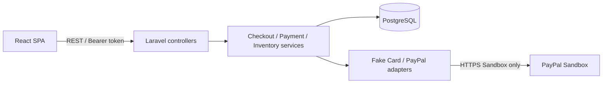

# Eneba Internship Assignment

## Project Overview

A small digital game marketplace built for the Eneba Software Engineer Internship assignment. Visitors browse games and seller offers, keep a local shopping cart, and sign in to reserve stock and complete a demo purchase. Paid orders expose their assigned digital keys to their owner.

All payment options are for demonstration: Fake Card is a simulator and PayPal uses Sandbox exclusively. The supplied inventory consists of synthetic, non-redeemable keys.

Published demo: [frontend](https://eneba-assignment-phi.vercel.app) and [API health](https://eneba-assignment-tpln.onrender.com/api/health). Payment availability depends on the deployed runtime flags and Sandbox configuration.

## Tech Stack

- Backend: PHP 8.4, Laravel 13, Laravel Sanctum 4, Eloquent and PHPUnit 12.
- Database: PostgreSQL 17, including `pg_trgm` search support.
- Frontend: React 19, TypeScript 7, Vite 8, React Router 7 and CSS Modules; Oxlint for linting.
- Development: Docker Compose, Node.js 24, Composer and npm lock files.
- Deployment: Vercel frontend, Render backend using FrankenPHP, and Neon PostgreSQL.

Major versions above are verified against the manifests and Dockerfiles. Lock files determine exact installed dependency versions. No UI component library is used.

## Features

- Active-game catalog with popular/alphabetical ordering and 12-item pagination.
- Case-insensitive substring and typo-tolerant search, suggestions and preview.
- Game details with regions, seller offers, EUR prices and available quantities.
- Registration, login and logout using expiring Sanctum Bearer tokens.
- Persistent browser cart, quantity controls, stock-change feedback and account isolation.
- Server-priced Checkout with idempotent order creation and 15-minute reservations.
- Fake Card success/failure simulation and PayPal Sandbox approval/capture.
- Transactional sale of the original reserved keys and owner-only key delivery.
- Responsive catalog, cart and payment UI, mobile Checkout dock and expandable order details.
- Local Retry actions and safe recovery from uncertain payment responses.

## Architecture

The backend is a Laravel monolith with controllers, application services, Eloquent models and payment adapters separated by responsibility. It does not contain independently deployed domain services. React talks to the REST API; PostgreSQL holds orders, payment attempts, inventory and authentication tokens.



The backend owns prices, payment status and key assignment. Provider HTTP requests run outside DB transactions; local completion uses short transactions and locks.

Details: [authentication](docs/authentication.md), [catalog navigation](docs/catalog-navigation.md), [search](docs/game-search.md), [schema](docs/checkout-schema.md), [Checkout services](docs/checkout-services.md), [payments](docs/payments.md), [frontend cart](docs/frontend-cart.md), and [frontend Checkout](docs/frontend-checkout.md).

## Local Setup

Requires Docker Desktop with Linux containers and Docker Compose. The commands below use PowerShell from the repository root. Bash/WSL can use the same Docker commands and `cp` instead of `Copy-Item`.

### 1. Clone and configure

Replace `REPOSITORY_URL` with the repository URL supplied to the reviewer:

```powershell
git clone "REPOSITORY_URL" eneba-assignment
cd eneba-assignment
```

For a fresh checkout only; do not overwrite existing configuration:

```powershell
Copy-Item .env.example .env
Copy-Item backend/.env.example backend/.env
Copy-Item frontend/.env.example frontend/.env
```

- Root `.env`: Compose database settings and backend/frontend URLs.
- `backend/.env`: application secrets and payment settings. Configure an independent random `DIGITAL_KEY_FINGERPRINT_SECRET` of at least 32 bytes before seeding keys. Keep it stable and distinct from `APP_KEY`.
- Set `PAYMENT_DEMO_ENABLED=true` in `backend/.env` to use Fake Card locally.
- Leave PayPal disabled until Sandbox credentials and callback URLs are configured; see [payments](docs/payments.md).
- `frontend/.env`: API URL when Vite runs outside Compose. Compose supplies `VITE_API_BASE_URL` from the root configuration.

Do not put remote `DATABASE_URL`/`DB_URL` values in the local backend environment. Compose supplies local `DB_*` settings, but a configured connection URL can override them.

### 2. Start services

```powershell
docker compose up -d --build
docker compose ps
```

The development entrypoint installs locked Composer dependencies, generates a local `APP_KEY` if absent, and runs migrations. The frontend runs `npm ci` before Vite. Seeders are not automatic. Source files are bind-mounted; dependencies and database data use named volumes.

If needed, generate a new fingerprint secret locally with the running PHP container, then save its output privately in `backend/.env`:

```powershell
docker compose exec -T backend php -r 'echo bin2hex(random_bytes(32)), PHP_EOL;'
```

Do not regenerate an existing encryption key or fingerprint secret for a database containing keys. If Laravel configuration was explicitly cached, refresh that local cache after changing settings:

```powershell
docker compose exec -T backend php artisan config:clear
```

Changes to Compose-supplied variables require recreating the affected service; editing `backend/.env` does not override an environment variable already supplied by Compose.

### 3. Verify migrations and seed fresh demo inventory

First confirm the connection is the local Compose PostgreSQL, not Neon or another remote database.

```powershell
docker compose exec -T backend php artisan migrate
docker compose exec -T backend php artisan migrate:status
docker compose exec -T backend php artisan db:seed --class=GameSeeder --no-interaction
docker compose exec -T backend php artisan db:seed --class=GamePopularitySeeder --no-interaction
docker compose exec -T backend php artisan db:seed --class=SellerSeeder --no-interaction
docker compose exec -T backend php artisan db:seed --class=OfferSeeder --no-interaction
docker compose exec -T backend php artisan db:seed --class=DigitalKeySeeder --no-interaction
```

`GamePopularitySeeder` is optional demonstration ranking data. The initial seeders produce 40 games, five sellers, 120 offers and 493 synthetic keys on a fresh database. `GameSeeder` leaves cover URLs empty, so the UI displays its fallback. These are sample values, not commercial data.

Do not substitute bare `db:seed`: the default `DatabaseSeeder` creates a factory user, not the marketplace inventory. Register your own test account through the UI. Do not blindly rerun `DigitalKeySeeder` after purchases: it refuses inventory containing reserved/sold keys or inconsistent counts. See [demo inventory](docs/local-marketplace-offers.md).

### 4. Open the application

- Frontend: <http://localhost:5173>
- Backend health and DB connection: <http://localhost:8000/api/health>
- Laravel health: <http://localhost:8000/up>
- Optional host PostgreSQL connection: `localhost:5433`; backend containers use `postgres:5432`.

Browse a game, add a seller offer, open the cart, proceed to Checkout and register or sign in. Choose Fake Card for a self-contained local demonstration.

```powershell
docker compose logs -f backend frontend
docker compose down
```

Normal shutdown preserves volumes. Removing database volumes deletes local data and is not part of this setup procedure.

## Payments

**Fake Card** simulates success or failure without collecting card details or charging money. It requires `PAYMENT_DEMO_ENABLED=true`. `FakeCardGateway::assertDemo()` also requires an allowed environment: local, testing, demo or production. This permits explicit use in the deployed demonstration while keeping `APP_ENV=production`. Leave the flag disabled for any real marketplace or valuable inventory: a signed-in customer can choose a simulated successful payment.

**PayPal Sandbox** requires backend Sandbox credentials: `PAYPAL_ENABLED`, `PAYPAL_CLIENT_ID`, `PAYPAL_CLIENT_SECRET`, `PAYPAL_MERCHANT_ID`, `PAYPAL_RETURN_URL` and `PAYPAL_CANCEL_URL`. Client ID and Secret must be nonempty; `PAYPAL_MERCHANT_ID` is currently a configuration field, not a separate payee-verification check. No Live API endpoint is used.

The backend creates a PayPal Order, the browser opens its approved Sandbox URL, and the return flow asks the backend to confirm/capture. Only verified completed capture data can result in `paid` and key delivery. A pending response or timeout is not a failed payment. See [payment states, idempotency and recovery](docs/payments.md).

## Testing

Run commands from the repository root with development services running:

```powershell
# SQLite in-memory safety check, then the normal PHPUnit suite
docker compose exec -T backend php vendor/bin/phpunit --filter TestDatabaseIsolationTest --do-not-cache-result
docker compose exec -T backend php vendor/bin/phpunit --do-not-cache-result

# Native frontend tests, type checking, lint, production build
docker compose exec -T frontend node --test tests/*.test.mjs
docker compose exec -T frontend npx tsc -b --pretty false
docker compose exec -T frontend npm run lint
docker compose exec -T frontend npm run build -- --outDir /tmp/eneba-review-build
```

The main PHPUnit configuration forces SQLite `:memory:` and rejects unsafe database connections. PostgreSQL-specific behavior is covered by six separate suites, each requiring a new empty disposable PostgreSQL database. Do not run them against the working database or Neon.

Browser tests use an existing Playwright/Chromium installation supplied by the test environment; Playwright is not a project dependency. They mock API traffic. A separate opt-in browser E2E uses real Laravel and disposable PostgreSQL with synthetic keys and Fake Card.

See [testing instructions](docs/testing.md) for all PostgreSQL suite commands, browser environment variables, Linux browser-library requirements and the real isolated E2E script. Deployment-script offline tests are documented in [production database operations](docs/production-database.md).

## Deployment

The existing deployment separates Vercel (frontend), Render (backend) and Neon (PostgreSQL). It is a manual configuration/deployment workflow; there is no claim of a complete automated release pipeline.

| Target | Environment variable names |
| --- | --- |
| Vercel | `VITE_API_BASE_URL` |
| Render: application and database | `APP_ENV`, `APP_DEBUG`, `APP_KEY`, `APP_URL`, `FRONTEND_URL`, `DB_CONNECTION`, `DATABASE_URL`, `DIGITAL_KEY_FINGERPRINT_SECRET` |
| Render: logging/runtime | `LOG_CHANNEL`, `LOG_LEVEL`, `PORT` |
| Render: demonstration payments | `PAYMENT_DEMO_ENABLED`, `PAYPAL_ENABLED`, `PAYPAL_CLIENT_ID`, `PAYPAL_CLIENT_SECRET`, `PAYPAL_MERCHANT_ID`, `PAYPAL_RETURN_URL`, `PAYPAL_CANCEL_URL` |

Use HTTPS URLs for deployed API and callbacks. Vite embeds its API URL at build time. Vercel uses `frontend/`, `npm run build`, output `dist` and the existing SPA rewrite. Render uses `backend/Dockerfile.prod` with context `backend/`; migrations and key generation do not run on production startup. Neon schema changes and selected seeders require separate, explicitly authorized operations through the existing script.

See [deployment](docs/production-deployment.md) and [production database operations](docs/production-database.md). Keep credentials private and preserve the encryption/fingerprint secrets for existing inventory.

## Known Limitations

- PayPal is Sandbox-only. There are no Live payments, refunds, webhooks or background payment reconciliation.
- Once confirmation starts before the deadline, a protected PayPal reservation can remain reserved while its result is uncertain, including when payer action is still required. Cancellation is blocked. Recovery uses the existing order and verified provider result; unresolved cases need manual investigation, not an unconditional timeout release.
- Ordinary reservation expiration is lazy: order reads/cancellation and related Checkout creation perform cleanup. There is no scheduled inventory-release job.
- Account / Order History is still a protected placeholder; there is no implemented order-history listing.
- Fake Card must only be enabled for a demonstration with nonvaluable inventory.
- Cart data is browser-local. Unowned legacy carts are treated as guest carts; ownership cannot be reconstructed retroactively. Separate persistent baskets for multiple accounts are not provided.
- Demo seeders are not a production inventory importer. Images must be supplied through existing game data; the game seeder does not populate cover URLs.
- Search and offer rendering target a small catalog; no large-scale performance guarantee is made.

Historical setup and audit records are retained in [setup report](docs/setup-report.md) and [technical audit](docs/technical-audit.md). They are not substitutes for the current setup and payment instructions. AI session logs and historical prompts are separate records and were not rewritten as current documentation.
